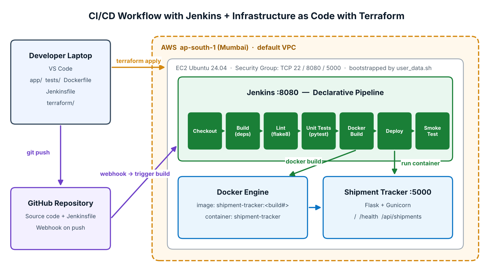

# Jenkins CI/CD + Terraform on AWS — Shipment Tracker

**Ashwini Arude**

A Flask app delivered by a Jenkins pipeline (**Checkout → Build → Lint → Unit Tests → Docker Build → Deploy → Smoke Test**) running on an AWS EC2 server that is provisioned entirely with **Terraform**.



## Quick start

```powershell
# 1. Provision the server (from terraform/)
cd terraform
copy terraform.tfvars.example terraform.tfvars
terraform init
terraform plan
terraform apply

# 2. Open the Jenkins URL from `terraform output`, create a Pipeline job
#    -> Pipeline script from SCM -> this repo -> Jenkinsfile, then Build Now

# 3. App is live at http://<public-ip>:5000

# 4. Clean up
terraform destroy
```

## Where things are

| Path | What |
|---|---|
| `Jenkinsfile` | Declarative CI/CD pipeline |
| `terraform/` | Root module (`versions.tf`, `variables.tf`, `main.tf`, `outputs.tf`) |
| `terraform/modules/jenkins-server/` | Reusable module: security group + EC2 |
| `terraform/scripts/user_data.sh` | First-boot install of Java 21, Jenkins, Docker, Python |
| `app/`, `tests/`, `Dockerfile` | Flask app, 9 pytest tests, container image |
| `docs/GUIDE.md` | Full step-by-step execution guide with screenshot list |
| `docs/VIDEO_SCRIPT.md` | 5-minute demo script with commands |
| `docs/CLAUDE_CODE_PROMPT.md` | Prompt to paste into Claude Code in VS Code |
| `docs/Report_Template.docx` | Report with `[[SS-xx]]` screenshot placeholders |
| `scripts/build_report.py` | Inserts `screenshots/SS-xx.png` into the report → `docs/Final_Report.docx` |

## Endpoints

`/` dashboard · `/health` · `/api/version` · `/api/shipments` (GET, POST) · `/api/shipments/<id>`
